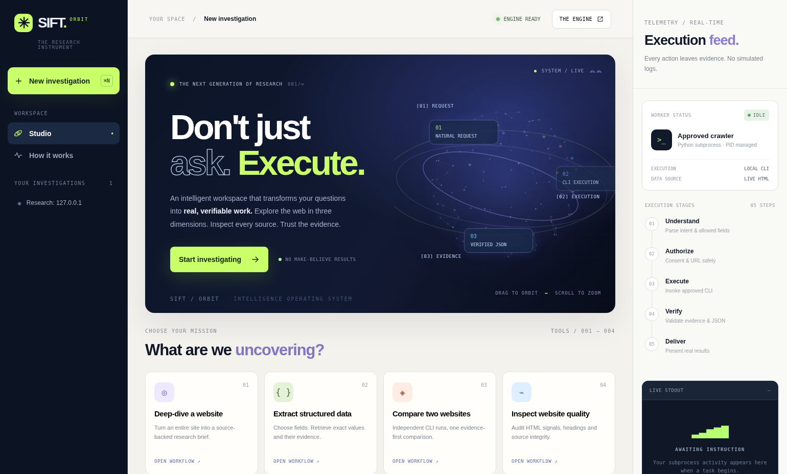
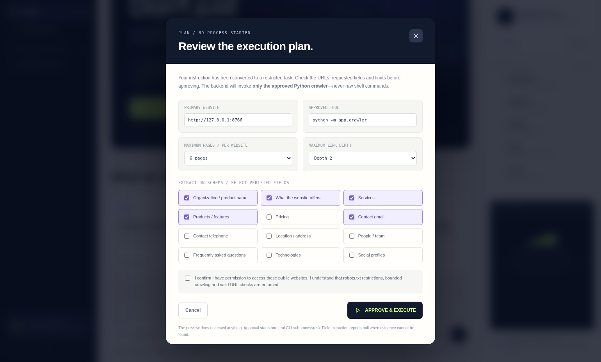
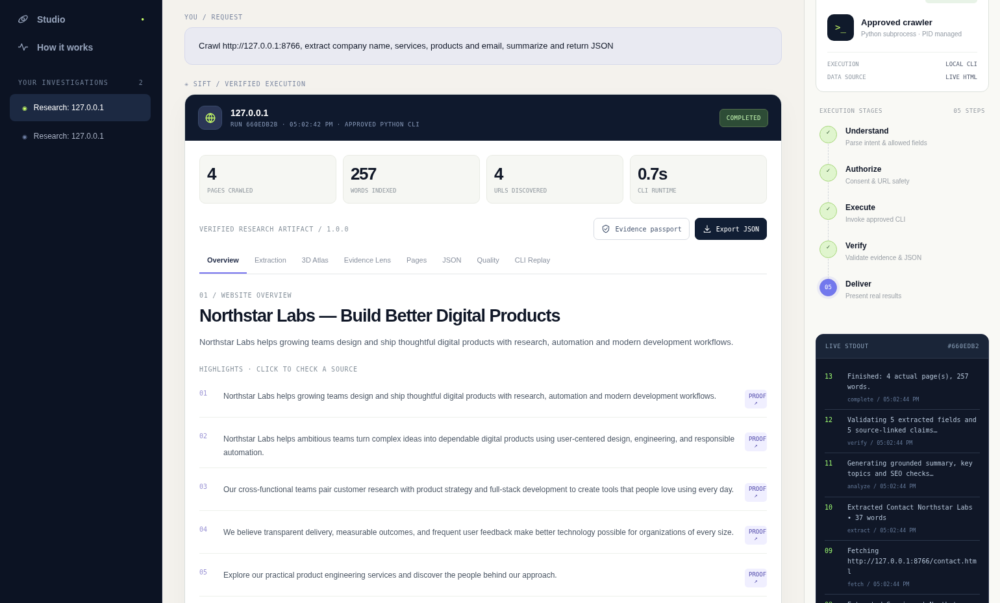
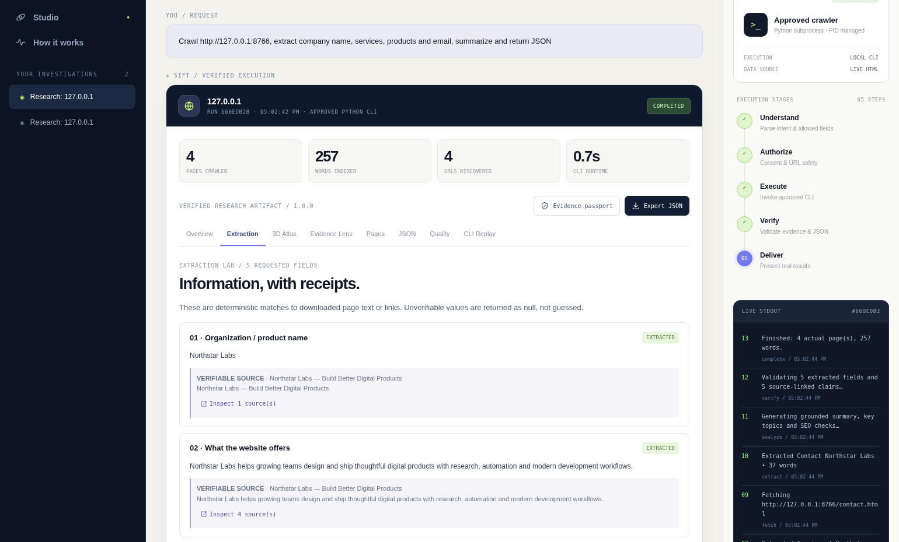
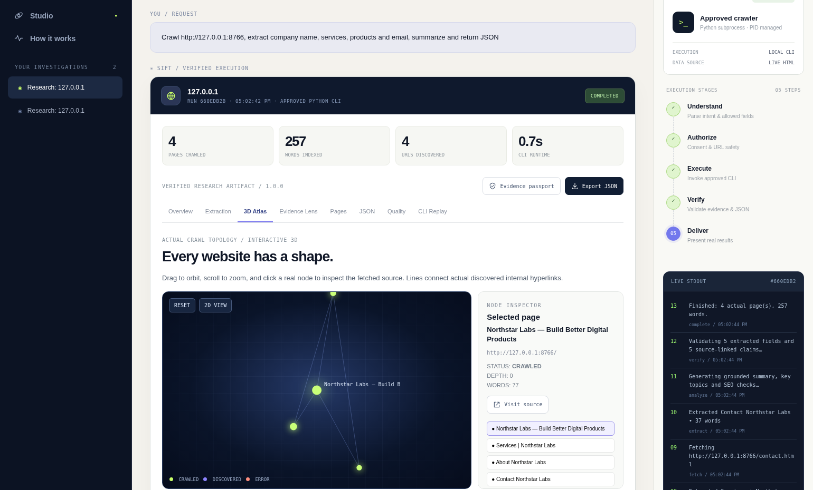
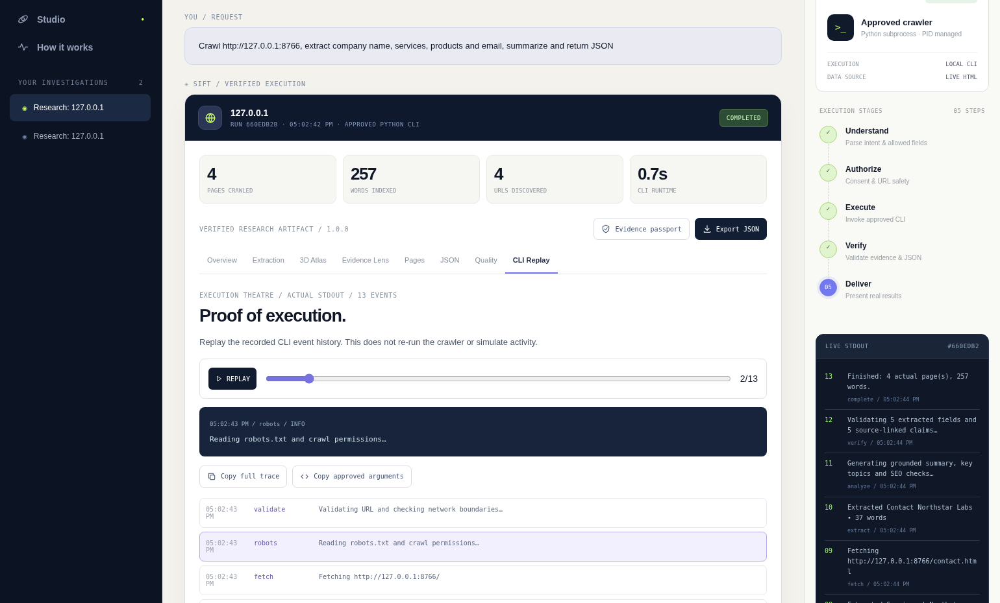
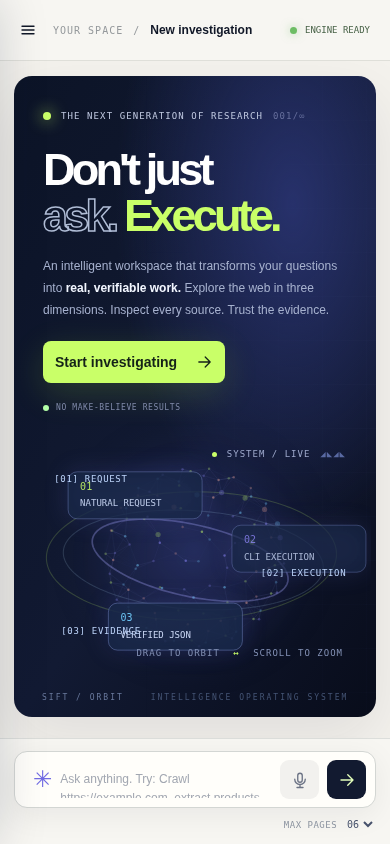

# Sift Orbit — Website Intelligence with CLI Execution Evidence

> **BuildSprint · Round 2 — CLI-Driven AI Chat Execution for Complex Tasks**

<div align="center">



### [🌐 Live Demo](https://siftorbit-workelate.netlify.app) &nbsp;·&nbsp; [📁 Demo Video & Assets](https://drive.google.com/drive/folders/1m0YSllHjryn6kheZi90NYskcJnoqwGFS) &nbsp;·&nbsp; [💻 GitHub](https://github.com/ammureddie49-lab/sift)

</div>

---

Sift Orbit turns a natural-language instruction into a real, auditable website research report. Type something like:

> *"Crawl https://example.com, extract the important information, give me a summary, and return the extracted data in JSON format."*

The FastAPI backend validates the request, launches a **separate Python CLI subprocess** (`python -m app.crawler`) with an allow-listed argument set, captures live JSONL stdout progress, waits for the process exit code, validates the JSON artifact, and returns a verifiable research report — with every step visible in the **CLI Trace** tab.

**No API key required.** The core crawl, extraction, and summary are entirely deterministic. An OpenAI-compatible LLM is optional and only used for grounded follow-up Q&A.

---

## Table of Contents

1. [Live Demo & Assets](#1-live-demo--assets)
2. [Screenshots](#2-screenshots)
3. [Prerequisites](#3-prerequisites)
4. [Installation](#4-installation)
5. [Environment Variables](#5-environment-variables)
6. [Running the Application](#6-running-the-application)
7. [The CLI Tool — `app.crawler`](#7-the-cli-tool--appcrawler)
8. [Running the Tests](#8-running-the-tests)
9. [3D Crawl Atlas](#9-3d-crawl-atlas)
10. [Project Structure](#10-project-structure)
11. [Architecture Overview](#11-architecture-overview)
12. [Security Notes](#12-security-notes)

---

## 1. Live Demo & Assets

| Resource | Link |
|---|---|
| 🌐 **Live deployment** | [https://siftorbit-workelate.netlify.app](https://siftorbit-workelate.netlify.app) |
| 📁 **Demo video, walkthrough & assets** | [Google Drive folder](https://drive.google.com/drive/folders/1m0YSllHjryn6kheZi90NYskcJnoqwGFS) |
| 💻 **GitHub repository** | [https://github.com/ammureddie49-lab/sift](https://github.com/ammureddie49-lab/sift) |

> The live deployment serves the full frontend UI. For complete CLI execution (real subprocess crawling, JSON artifact generation, live stdout events) run the FastAPI backend locally — instructions in [Section 6](#6-running-the-application).

---

## 2. Screenshots

### Orbit Studio & Plan Approval

| Orbit UI | Plan approval |
|---|---|
|  |  |

### Completed Research & Extraction Studio

| Completed research | Extraction studio |
|---|---|
|  |  |

### 3D Crawl Atlas



> Every node is a **real fetched page**. Every edge is an **actual internal hyperlink** discovered during the crawl. Drag to orbit, scroll to zoom, click a node to inspect its page data. See [Section 9](#9-3d-crawl-atlas) for full details.

### CLI Replay & Mobile

| CLI Replay | Mobile |
|---|---|
|  |  |

---

## 3. Prerequisites

| Requirement | Version | Notes |
|---|---|---|
| **Python** | 3.11 or newer | `python --version` to check |
| **pip** | bundled with Python | used inside the venv |
| **Internet access** | — | for `pip install` and crawling public sites |
| **Node.js / npm** | ❌ not needed | frontend is plain HTML/CSS/JS |

---

## 4. Installation

### Windows (PowerShell)

```powershell
cd path\to\Sift_Orbit

py -3 -m venv .venv
.\.venv\Scripts\python.exe -m pip install -r requirements.txt
```

> If `py -3` is not found, use `python -m venv .venv`. Make sure the Python on your PATH is 3.11+.

### macOS / Linux

```bash
cd path/to/Sift_Orbit

python3 -m venv .venv
source .venv/bin/activate
pip install -r requirements.txt
```

### Quick-start scripts (alternative)

| Platform | Command |
|---|---|
| Windows | `powershell -ExecutionPolicy Bypass -File .\start.ps1` |
| macOS / Linux | `./start.sh` |

Both scripts create the venv if absent, install dependencies, and start the server.

---

## 5. Environment Variables

Copy the example file and edit it:

```powershell
# Windows
Copy-Item .env.example .env

# macOS / Linux
cp .env.example .env
```

| Variable | Default | Required | Description |
|---|---|---|---|
| `LLM_API_KEY` | *(empty)* | **No** | OpenAI-compatible API key. Leave blank — the app runs fully without one. |
| `LLM_BASE_URL` | `https://api.openai.com/v1` | No | Base URL for any OpenAI-compatible endpoint. |
| `LLM_MODEL` | `gpt-4.1-mini` | No | Model name sent to the API. |
| `ALLOW_PRIVATE_NETWORK` | `false` | No | Set `true` **only** for local testing against `127.0.0.1`. Never enable on a public server. |
| `MAX_CONCURRENT_JOBS` | `2` | No | Max simultaneous crawler jobs (1–5). |

> ⚠️ Never commit `.env` or real API keys. `.env` is already in `.gitignore`.

---

## 6. Running the Application

### Standard start

**Windows:**
```powershell
.\.venv\Scripts\python.exe -m uvicorn app.main:app --reload --host 127.0.0.1 --port 8000
```

**macOS / Linux:**
```bash
python -m uvicorn app.main:app --reload --host 127.0.0.1 --port 8000
```

Open **http://127.0.0.1:8000** — you should see the green **Engine Ready** indicator. Press `Ctrl+C` to stop.

---

### Local demo with the bundled test site

The repo includes a four-page static site (`demo_site/`) so you can run a fully reproducible crawl with no dependency on any public URL.

Open **two terminals** in the project directory:

**Terminal A — serve the demo site:**
```powershell
# Windows
.\.venv\Scripts\python.exe -m http.server 8765 --bind 127.0.0.1 --directory demo_site
```
```bash
# macOS / Linux
python -m http.server 8765 --bind 127.0.0.1 --directory demo_site
```

**Terminal B — start Sift with loopback access enabled:**
```powershell
# Windows
$env:ALLOW_PRIVATE_NETWORK = "true"
.\.venv\Scripts\python.exe -m uvicorn app.main:app --reload --host 127.0.0.1 --port 8000
```
```bash
# macOS / Linux
ALLOW_PRIVATE_NETWORK=true python -m uvicorn app.main:app --reload --host 127.0.0.1 --port 8000
```

Open **http://127.0.0.1:8000** and enter:

```
Crawl http://127.0.0.1:8765, summarize the website,
extract the important information and give me valid JSON.
```

**Expected result:** Sift fetches all four local pages over real HTTP, emits live progress events, writes a JSON artifact to `data/results/`, and the UI shows an overview, source pages, structured JSON, page-quality audit, intent plan, **3D Crawl Atlas**, and full CLI trace.

---

## 7. The CLI Tool — `app.crawler`

The crawler is a standalone Python module — the execution engine. The FastAPI backend launches it as a subprocess with a fixed, allow-listed argument set. You can also invoke it directly:

```powershell
# Windows
.\.venv\Scripts\python.exe -m app.crawler `
  --url https://example.com `
  --max-pages 3 `
  --max-depth 2 `
  --timeout 12 `
  --output data/results/my-test.json
```

```bash
# macOS / Linux
python -m app.crawler \
  --url https://example.com \
  --max-pages 3 \
  --max-depth 2 \
  --timeout 12 \
  --output data/results/my-test.json
```

### CLI arguments

| Argument | Description | Default |
|---|---|---|
| `--url` | Target website URL (HTTP/HTTPS) | required |
| `--max-pages` | Maximum pages to crawl (1–15) | `6` |
| `--max-depth` | Maximum link-follow depth | `2` |
| `--timeout` | Per-page HTTP timeout in seconds | `12` |
| `--fields-json` | JSON array of extraction field keys | auto |
| `--output` | Path for the JSON result artifact | required |

### Output format

The crawler emits newline-delimited JSON (JSONL) progress events on **stdout**:

```json
{"event": "progress", "step": "fetch", "url": "https://example.com", "progress": 20, "message": "Fetched page 1"}
```

On completion it writes a validated JSON artifact to `--output` and exits `0` (success) or non-zero (failure/partial).

---

## 8. Running the Tests

```powershell
# Windows
.\.venv\Scripts\python.exe -m pip install -r requirements-dev.txt
.\.venv\Scripts\python.exe -m pytest -q
```

```bash
# macOS / Linux
pip install -r requirements-dev.txt
pytest -q
```

The test suite covers:

| File | What it tests |
|---|---|
| `test_security.py` | URL validation, SSRF protection, normalization |
| `test_analysis.py` | Extractive summaries and keyword extraction |
| `test_api.py` | FastAPI session and task endpoints |
| `test_orchestration.py` | Real subprocess execution and artifact validation |
| `test_end_to_end.py` | Full crawl → JSON artifact pipeline |
| `test_orbit_features.py` | 3D atlas graph endpoints, compare, evidence lens |
| `test_windows_subprocess.py` | Windows subprocess and event-loop compatibility |

Integration tests spin up their own temporary HTTP server and enable loopback only for the duration of that test.

---

## 9. 3D Crawl Atlas


The **3D Crawl Atlas** is an interactive network graph built entirely from the real data returned by each crawl. It is not a decoration — every element maps directly to the CLI output.

| Element | What it represents |
|---|---|
| **Green node** | A page that was successfully crawled |
| **Purple node** | A URL discovered via a hyperlink but not crawled (depth/page limit) |
| **Red node** | A page that returned an error or was blocked |
| **Edge (line)** | An actual internal hyperlink found in the page HTML |

### Interactions

| Action | Effect |
|---|---|
| **Drag** | Orbit the graph in 3D |
| **Scroll** (Shift+scroll on desktop) | Zoom in and out |
| **Click a node** | Opens the Node Inspector — shows the page title, URL, depth, word count, and a link to the original source |
| **2D / 3D toggle** | Flatten the graph to a top-down layout |
| **Reset** | Restores the default rotation and zoom |

### How it is built

After a crawl completes, `app/crawler.py` writes a `graph` object into the JSON artifact:

```json
{
  "graph": {
    "nodes": [
      {"id": "...", "url": "https://example.com", "title": "Example", "status": "crawled", "depth": 0},
      {"id": "...", "url": "https://example.com/about", "title": "About", "status": "crawled", "depth": 1}
    ],
    "edges": [
      {"source": "...", "target": "..."}
    ]
  }
}
```

The frontend reads this graph, distributes nodes across a 3D sphere using a Fibonacci lattice, then renders them with a depth-projection Canvas engine (`Scene3D` class in `web/app.js`) — no WebGL, no external 3D library. Rotation, zoom, pointer picking and node selection are all handled with plain 2D Canvas math.

After a completed crawl, open the **3D Atlas** tab inside the task card to explore it. On mobile the adjacent page list stays usable alongside the graph.

---

## 10. Project Structure

```
Sift_Orbit/
├── app/
│   ├── main.py        FastAPI endpoints, intent router, subprocess orchestration
│   ├── crawler.py     Standalone CLI tool — JSONL stdout + JSON artifact + graph output
│   ├── security.py    URL/DNS validation, SSRF protection, same-host guard
│   ├── analysis.py    Extractive summary, keyword extraction, page quality checks
│   ├── database.py    SQLite persistence (sessions, messages, tasks, logs)
│   ├── llm.py         Optional OpenAI-compatible follow-up Q&A
│   ├── planner.py     Deterministic constrained intent planner
│   └── schemas.py     Pydantic models for validated CLI artifacts
├── web/
│   ├── index.html     Responsive chat UI + 3D orbital scene
│   ├── styles.css     Layout, 3D transforms, mobile breakpoints
│   └── app.js         UI logic, polling, tabs, 3D Crawl Atlas, CLI replay
├── demo_site/         Four-page static site for local HTTP demo
├── tests/             Pytest suite (unit + integration + end-to-end)
├── screenshots/       Evidence screenshots (07–13 are latest Orbit UI)
├── data/results/      Runtime JSON artifacts (created on first run)
├── .env.example       Environment variable template
├── requirements.txt   Runtime dependencies
├── requirements-dev.txt  Test dependencies
├── start.ps1          Windows guided start script
└── start.sh           macOS/Linux guided start script
```

---

## 11. Architecture Overview

```
Browser / Chat UI
    │
    │  POST /api/plan        ← read-only: build + validate intent, no CLI yet
    │  POST /api/execute     ← user explicitly confirms crawl permission
    ▼
FastAPI (app/main.py)
    │── validate URL (SSRF / DNS / scheme / port checks)
    │── create task in SQLite (status: queued)
    │
    │  asyncio.to_thread → subprocess.Popen (shell=False)
    │    sys.executable, '-m', 'app.crawler',
    │    '--url', <validated>, '--max-pages', ..., '--output', <approved path>
    ▼
app.crawler (separate process)
    │── check robots.txt
    │── HTTPX requests + BeautifulSoup HTML parsing
    │── bounded traversal (max 15 pages, depth 2, 2 MB/page, 12 s/page)
    │── emit JSONL progress events → stdout
    │── build URL graph (nodes + edges) from discovered links
    └── write validated JSON artifact → data/results/<task_id>.json
    ▼
FastAPI (validation)
    │── capture stdout/stderr/exit code
    │── validate artifact schema (Pydantic CrawlArtifact)
    │── persist to SQLite (status: completed / partial / failed)
    ▼
Browser / Results
    │── poll GET /api/tasks/{id} while running
    │── Overview · Extraction · 3D Atlas · Evidence Lens · Pages · JSON · Quality · CLI Replay
    └── GET /api/tasks/{id}/download  (JSON artifact)
```

User input **never reaches `shell=True`**. The only executable the backend can launch is `sys.executable -m app.crawler` with a typed, allow-listed argument set.

---

## 12. Security Notes

- Only `http://` and `https://` URLs — no credentials, arbitrary schemes, or file paths.
- Loopback, private, reserved, and cloud-metadata addresses blocked by default (DNS-resolved).
- Unusual ports blocked; loopback testing requires the explicit `ALLOW_PRIVATE_NETWORK=true` flag.
- Same-host traversal only; external redirects refused. `robots.txt` checked conservatively.
- Hard limits: 15 pages, depth 2, 2 MB/page, 12 s/page timeout, 150 s total job timeout.
- Max 2 concurrent workers (configurable 1–5); cancellation and restart recovery implemented.
- Result artifacts written only within `data/results/`; path traversal checked on every read.
- UI escapes all untrusted website text before DOM insertion.


