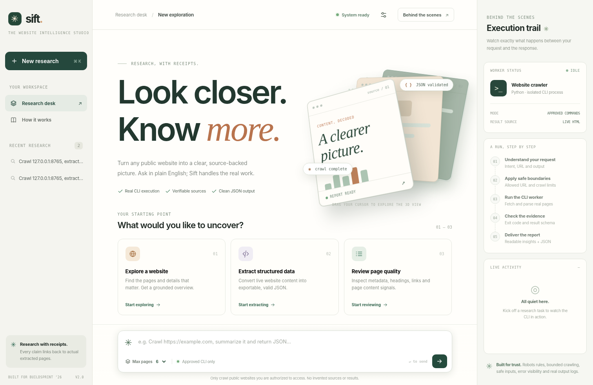
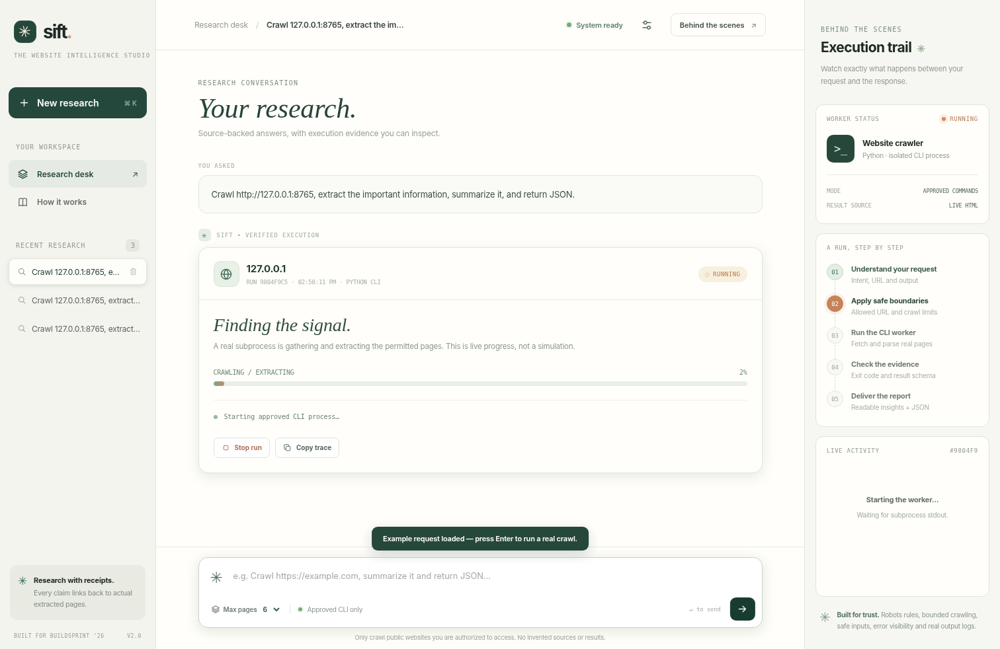
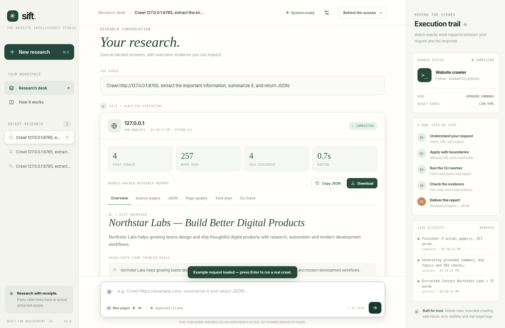
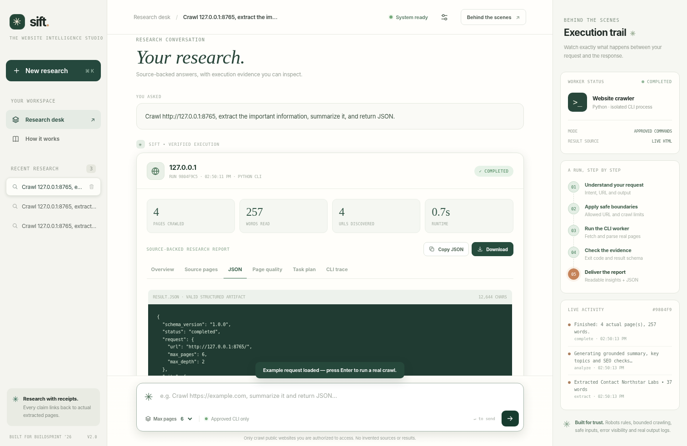
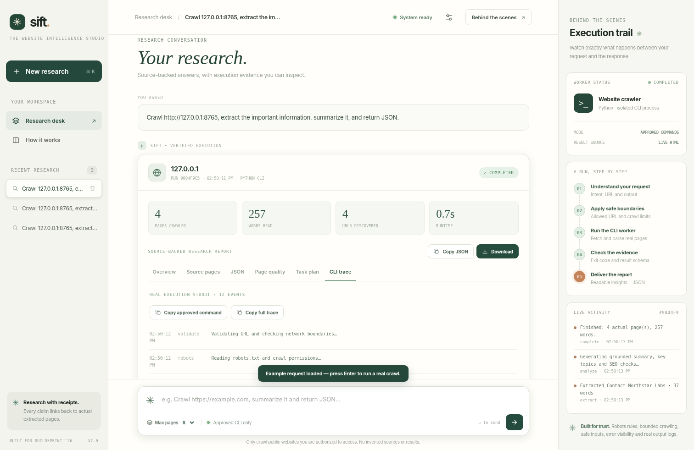
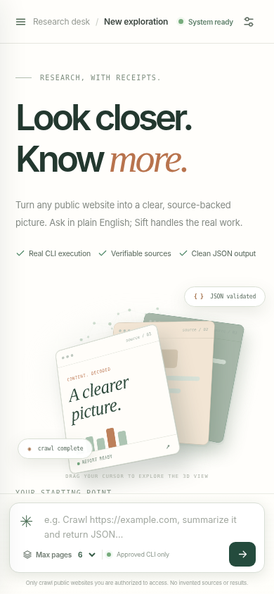

# Sift Orbit — Website Intelligence with CLI Execution Evidence

> **BuildSprint · Round 2 — CLI-Driven AI Chat Execution for Complex Tasks**



Sift Orbit is a full-stack web application that turns a natural-language instruction into a real, auditable website research report. You type something like:

> *"Crawl https://example.com, extract the important information, give me a summary, and return the extracted data in JSON format."*

The FastAPI backend validates the request, launches a **separate Python CLI process** (`python -m app.crawler`) with an allow-listed set of arguments, captures its live JSONL stdout, waits for the exit code, validates the JSON artifact, and returns a verifiable research report to the chat UI — with every step visible in the **CLI Trace** tab.

**No API key is required.** The core crawl and summary are deterministic. An OpenAI-compatible LLM is optional and only used for follow-up Q&A.

---

## Table of Contents

1. [Prerequisites](#1-prerequisites)
2. [Installation](#2-installation)
3. [Environment Variables](#3-environment-variables)
4. [Running the Application](#4-running-the-application)
5. [The CLI Tool — `app.crawler`](#5-the-cli-tool--appcrawler)
6. [Running the Tests](#6-running-the-tests)
7. [Live Demo / Access Instructions](#7-live-demo--access-instructions)
8. [Project Structure](#8-project-structure)
9. [Architecture Overview](#9-architecture-overview)
10. [Security Notes](#10-security-notes)

---

## 1. Prerequisites

| Requirement | Version | Notes |
|---|---|---|
| **Python** | 3.11 or newer | `python --version` to check |
| **pip** | bundled with Python | used inside the venv |
| **Internet access** | — | for the initial `pip install` and for crawling public sites |
| **Node.js / npm** | ❌ not needed | frontend is plain HTML/CSS/JS |

---

## 2. Installation

Clone (or extract) the project, then create a virtual environment and install dependencies.

### Windows (PowerShell)

```powershell
# 1. Enter the project directory
cd path\to\Sift_Orbit

# 2. Create a virtual environment
py -3 -m venv .venv

# 3. Install runtime dependencies
.\.venv\Scripts\python.exe -m pip install -r requirements.txt
```

> If `py -3` is not found, use `python -m venv .venv` instead. Make sure the Python on your PATH is 3.11+.

### macOS / Linux

```bash
# 1. Enter the project directory
cd path/to/Sift_Orbit

# 2. Create a virtual environment
python3 -m venv .venv
source .venv/bin/activate

# 3. Install runtime dependencies
pip install -r requirements.txt
```

### Quick-start scripts (alternative)

| Platform | Command |
|---|---|
| Windows PowerShell | `powershell -ExecutionPolicy Bypass -File .\start.ps1` |
| macOS / Linux | `./start.sh` |

Both scripts create the venv if absent, install dependencies, and start the server.

---

## 3. Environment Variables

Copy the example file and edit it:

```powershell
# Windows
Copy-Item .env.example .env

# macOS / Linux
cp .env.example .env
```

| Variable | Default | Required | Description |
|---|---|---|---|
| `LLM_API_KEY` | *(empty)* | **No** | OpenAI-compatible API key. Leave blank to use built-in deterministic evidence search. |
| `LLM_BASE_URL` | `https://api.openai.com/v1` | No | Base URL for the LLM API (any OpenAI-compatible endpoint). |
| `LLM_MODEL` | `gpt-4.1-mini` | No | Model name passed to the LLM API. |
| `ALLOW_PRIVATE_NETWORK` | `false` | No | Set to `true` **only** for local testing against `127.0.0.1`. Never enable on a public server. |
| `MAX_CONCURRENT_JOBS` | `2` | No | Maximum number of simultaneous background crawler jobs (1–5). |

**The application runs fully without an API key.** All crawling, extraction, summarization, and JSON output are deterministic and require no external service.

> ⚠️ Never commit `.env` or real API keys to version control. `.env` is already in `.gitignore`.

---

## 4. Running the Application

### Standard start

**Windows:**
```powershell
.\.venv\Scripts\python.exe -m uvicorn app.main:app --reload --host 127.0.0.1 --port 8000
```

**macOS / Linux:**
```bash
python -m uvicorn app.main:app --reload --host 127.0.0.1 --port 8000
```

Then open **http://127.0.0.1:8000** in your browser. You should see a green **System ready** indicator.

Press `Ctrl+C` to stop.

### Local demo with the bundled test site

The repo includes a four-page static demo site (`demo_site/`) so you can run a fully reproducible crawl without depending on a public URL.

Open **two terminals** in the project directory:

**Terminal A — serve the demo site:**
```powershell
# Windows
.\.venv\Scripts\python.exe -m http.server 8765 --bind 127.0.0.1 --directory demo_site
```
```bash
# macOS / Linux
python -m http.server 8765 --bind 127.0.0.1 --directory demo_site
```

**Terminal B — start Sift with loopback access enabled:**
```powershell
# Windows
$env:ALLOW_PRIVATE_NETWORK = "true"
.\.venv\Scripts\python.exe -m uvicorn app.main:app --reload --host 127.0.0.1 --port 8000
```
```bash
# macOS / Linux
ALLOW_PRIVATE_NETWORK=true python -m uvicorn app.main:app --reload --host 127.0.0.1 --port 8000
```

Open **http://127.0.0.1:8000** and enter:

```
Crawl http://127.0.0.1:8765, summarize the website,
extract the important information and give me valid JSON.
```

**Expected result:** Sift fetches all four local pages via real HTTP, emits live progress events, writes a JSON artifact to `data/results/`, and the UI displays an overview, source pages, the JSON artifact, a page-quality audit, the intent plan, and the full CLI trace.

---

## 5. The CLI Tool — `app.crawler`

The CLI module is the execution engine. The FastAPI backend launches it as a subprocess with a fixed, allow-listed argument set. You can also run it directly:

```powershell
# Windows — direct CLI invocation
.\.venv\Scripts\python.exe -m app.crawler `
  --url https://example.com `
  --max-pages 3 `
  --max-depth 2 `
  --timeout 12 `
  --output data/results/my-test.json
```

```bash
# macOS / Linux
python -m app.crawler \
  --url https://example.com \
  --max-pages 3 \
  --max-depth 2 \
  --timeout 12 \
  --output data/results/my-test.json
```

### CLI arguments

| Argument | Description | Default |
|---|---|---|
| `--url` | Target website URL (HTTP/HTTPS) | required |
| `--max-pages` | Maximum pages to crawl (1–15) | `6` |
| `--max-depth` | Maximum link-follow depth | `2` |
| `--timeout` | Per-page HTTP request timeout in seconds | `12` |
| `--fields-json` | JSON array of extraction fields | auto |
| `--output` | Path for the JSON result artifact | required |

### CLI output format

The crawler emits newline-delimited JSON (JSONL) progress events to **stdout**:

```json
{"event": "progress", "step": "fetch", "url": "https://example.com", "progress": 20, "message": "Fetched page 1"}
```

On completion it writes a validated JSON artifact to the `--output` path and exits with code `0` (success) or non-zero (failure/partial).

---

## 6. Running the Tests

Install development dependencies first:

```powershell
# Windows
.\.venv\Scripts\python.exe -m pip install -r requirements-dev.txt
.\.venv\Scripts\python.exe -m pytest -q
```

```bash
# macOS / Linux
pip install -r requirements-dev.txt
pytest -q
```

The test suite covers:

- URL security and normalization (`test_security.py`)
- Extractive analysis and summaries (`test_analysis.py`)
- FastAPI session and task endpoints (`test_api.py`)
- Real subprocess execution and artifact validation (`test_orchestration.py`)
- End-to-end crawl → JSON artifact (`test_end_to_end.py`)
- Orbit/3D feature endpoints (`test_orbit_features.py`)
- Windows subprocess compatibility (`test_windows_subprocess.py`)

The integration tests spin up their own temporary HTTP server and enable loopback access only for the duration of that test.

---

## 7. Live Demo / Access Instructions

### Deployed URL

This project runs locally — no always-on public deployment is provided. Follow the steps below to reproduce the demo in under 3 minutes.

### Fastest reproduction path

```powershell
# 1. Clone / extract the project
# 2. Run the guided start script (creates venv, installs deps, starts server)
powershell -ExecutionPolicy Bypass -File .\start.ps1
```

Then open **http://127.0.0.1:8000** and paste:

```
Crawl https://example.com, extract the important information,
give me a summary, and return the extracted data in JSON format.
```

For a **fully self-contained demo** (no public internet dependency), use the two-terminal setup in [Section 4](#local-demo-with-the-bundled-test-site) with the bundled `demo_site/`.

### What to look for

| Tab | What it shows |
|---|---|
| **Overview** | Extractive summary and key topics from actual fetched pages |
| **Sources** | Each crawled URL, headings, and outbound links |
| **JSON** | Pretty-printed, downloadable structured artifact |
| **Quality** | Per-page heuristic checks (title, meta description, H1, lang) |
| **Plan** | The constrained intent plan the system built before executing |
| **Trace** | The exact CLI command, every JSONL stdout event, stderr, and exit code |

### Screenshots

| | |
|---|---|
|  |  |
|  |  |
|  |  |

---

## 8. Project Structure

```
Sift_Orbit/
├── app/
│   ├── main.py        FastAPI endpoints, intent router, subprocess orchestration
│   ├── crawler.py     Standalone CLI tool — JSONL stdout + JSON artifact output
│   ├── security.py    URL/DNS validation, SSRF protection, same-host guard
│   ├── analysis.py    Extractive summary, keyword extraction, page quality checks
│   ├── database.py    SQLite persistence (sessions, messages, tasks, logs)
│   ├── llm.py         Optional OpenAI-compatible follow-up Q&A
│   ├── planner.py     Deterministic constrained intent planner
│   └── schemas.py     Pydantic models for validated CLI artifacts
├── web/
│   ├── index.html     Responsive chat UI + 3D scene
│   ├── styles.css     Layout, 3D transforms, mobile breakpoints
│   └── app.js         UI logic, polling, tabs, 3D atlas, artifacts
├── demo_site/         Four-page static site for local HTTP demo
├── tests/             Pytest suite (unit + integration + end-to-end)
├── screenshots/       Evidence screenshots
├── data/results/      Runtime JSON artifacts (created on first run)
├── .env.example       Environment variable template
├── requirements.txt   Runtime dependencies
├── requirements-dev.txt  Test dependencies
├── start.ps1          Windows guided start script
└── start.sh           macOS/Linux guided start script
```

---

## 9. Architecture Overview

```
Browser / Chat UI
    │
    │  POST /api/plan        ← read-only: build + validate intent, no CLI yet
    │  POST /api/execute     ← user explicitly confirms permission
    ▼
FastAPI (app/main.py)
    │── validate URL (SSRF / DNS / scheme / port checks)
    │── create task record in SQLite (status: queued)
    │
    │  asyncio.to_thread → subprocess.Popen (shell=False)
    │    sys.executable, '-m', 'app.crawler',
    │    '--url', <validated>, '--max-pages', ..., '--output', <approved path>
    ▼
app.crawler (separate process)
    │── check robots.txt
    │── HTTPX requests + BeautifulSoup HTML parsing
    │── bounded traversal (max 15 pages, depth 2, 2 MB/page, 12 s/page)
    │── emit JSONL progress events → stdout
    └── write validated JSON artifact → data/results/<task_id>.json
    ▼
FastAPI (validation)
    │── capture stdout/stderr/exit code
    │── validate artifact schema (Pydantic CrawlArtifact)
    │── persist to SQLite (status: completed / partial / failed)
    ▼
Browser / Results
    │── poll GET /api/tasks/{id}  while running
    │── display Overview · Sources · JSON · Quality · Plan · Trace tabs
    └── GET /api/tasks/{id}/download   (JSON artifact)
```

User input **never reaches `shell=True`**. The only executable the backend can launch is `sys.executable -m app.crawler` with a typed, allow-listed argument set.

---

## 10. Security Notes

- Only `http://` and `https://` URLs; no credentials, arbitrary schemes, or file paths.
- Loopback, private, reserved, and cloud-metadata addresses are blocked by default (DNS-resolved).
- Unusual ports are blocked; loopback testing requires the explicit `ALLOW_PRIVATE_NETWORK=true` flag.
- Same-host traversal only; external redirects are refused. `robots.txt` is checked conservatively.
- Hard limits: 15 pages, depth 2, 2 MB/page, 12 s/page timeout, 150 s total job timeout.
- Maximum 2 concurrent workers (configurable 1–5); cancellation and restart recovery are implemented.
- Result artifacts are written only within `data/results/`; path traversal is checked on every read.
- The UI escapes all untrusted website text before DOM insertion.

> ⚠️ **Not a hardened multi-tenant service.** There is no authentication, rate limiting, or OS-level process sandbox. For any public deployment, add those controls and run the worker in an isolated, non-privileged container.

---

## AI & External Service Disclosure

This project was developed with AI coding assistance (OpenAI ChatGPT) for implementation and documentation. Runtime stack: Python, FastAPI, Uvicorn, HTTPX, BeautifulSoup4, SQLite, and vanilla HTML/CSS/JavaScript. The initial crawl and summary are deterministic; no external LLM is required at runtime. Optional OpenAI-compatible follow-up Q&A is user-configured.

**BuildSprint Round 2 deadline: 16 November 2026, 11:59 PM IST.**
